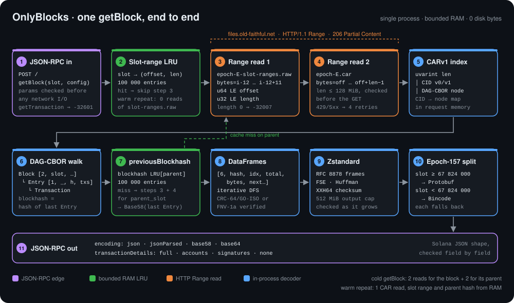

<div align="center">

# OnlyBlocks

**Historical Solana `getBlock` JSON-RPC in a single process, 0 disk bytes, 2 HTTP Range reads per block, and 0 third-party dependencies, implemented from scratch 24 times in 23 programming languages.**

Every server in this repository reads blocks straight out of the
[Old Faithful](https://files.old-faithful.net) archive and decodes CARv1,
DAG-CBOR, Zstandard, Protobuf and Bincode itself. It does this in AArch64
assembly, Fortran 2018, Bash + AWK, Erlang bit syntax and 19 other languages,
and all of them answer the same JSON-RPC requests with the same blocks.

**24 / 24** pass golden conformance · **24 / 24** pass the hostile-input audit · **24 / 24** match live mainnet

[How it works](#how-it-works) ·
[Leaderboard](#the-polyglot-leaderboard) ·
[Tour](#a-tour-of-the-implementations) ·
[Conformance](#conformance-and-security-suites) ·
[Add a language](#add-implementation-25-in-three-steps) ·
[Spec](SPEC.md)

</div>

---

## Quick start

Any implementation will do. Each one listens on `127.0.0.1:8899` and reads
`https://files.old-faithful.net` by default.

```sh
impls/rust/run.sh          # builds on first run, then serves

curl -s http://127.0.0.1:8899 -H 'Content-Type: application/json' -d '{
  "jsonrpc": "2.0", "id": 1, "method": "getBlock",
  "params": [302400001, {"maxSupportedTransactionVersion": 0, "transactionDetails": "signatures"}]
}'
```

Both settings can be overridden with `--bind HOST:PORT` / `ONLYBLOCKS_BIND`
and `--base-url URL` / `OLD_FAITHFUL_BASE_URL`. The full contract is in
[`SPEC.md`](SPEC.md).

## Why only blocks?

**A block can be found by arithmetic.** Slot `s` lives in epoch
`s / 432 000`, and its 12-byte location record sits at byte
`(s mod 432 000) × 12` of that epoch's `slot-ranges.raw`. One Range read
returns that record, and a second returns the block's exact bytes from the
epoch's `.car` file. There is no index to download and no database to run.
The server keeps no state on disk.

**A transaction cannot be found that way.** `getTransaction(signature)`
starts from a random 64-byte signature. To find the slot that holds it, you
need a signature index covering every transaction in the epoch. That index
runs to many gigabytes per epoch, and it has to be downloaded, stored or put
behind a database. The original crate-based oracle could only serve a
*slot-hinted* `getTransaction`.

**So OnlyBlocks serves only blocks.** `getTransaction`, like every method
other than `getBlock` and `getHealth`, returns `-32601 Method not found`
immediately. It does not parse params or make any upstream request
([SPEC §5.3](SPEC.md#53-dropped-methods)), and the conformance harness checks
that the mock origin's request counter stays at zero. Dropping the method
leaves each server:

| Property | What it means here |
|---|---|
| **Stateless** | Two bounded RAM caches: `slot → (offset, length)` and `slot → blockhash`, 100 000 entries each. Restarting loses nothing that matters. |
| **0 disk bytes** | No file is created, written, renamed or deleted after start-up, and the harness watches a private `TMPDIR` to check. |
| **Bounded memory** | CAR slices are capped at 128 MiB before the request is sent, and Zstandard output is capped at 512 MiB as it grows. Request bodies over 1 MiB are refused. |
| **0 third-party dependencies** | Each server uses only its language's standard library and the OS. No package manager runs at build time. |
| **A single process** | Each server is one OS process, with only the exceptions [SPEC §1](SPEC.md#1-core-philosophy) allows. BEAM forks its own port helpers. `bash-awk`, whose language is the shell, pipes Range bytes through `awk`, `sh` and `od`. `https://` reads may spawn the system `curl` ([§3.3](SPEC.md#33-tls--https-transport-exception)). |

## How it works

<p align="center">
  
</p>

Here is one `getBlock`, slot `302 400 001`, from request to response. The
numbers match the diagram.

```text
epoch    = slot / 432_000      302400001 / 432000 = 700
slot_idx = slot % 432_000      302400001 % 432000 = 1

GET /700/epoch-700-slot-ranges.raw   Range: bytes=12-23              → u64 LE offset | u32 LE length
GET /700/epoch-700.car               Range: bytes=offset-(offset+length-1)  → this block's CAR slice
```

1. **JSON-RPC in.** The server parses the JSON-RPC 2.0 envelope and checks
   the `getBlock` params *before* any I/O, so invalid params never reach the
   network. Batches hold 1 to 100 requests and run in order. Oversized and
   deeply nested bodies are rejected here.
2. **Slot-range LRU.** `slot → (offset, length)` is looked up in RAM. A hit
   skips step 3, which is why a warm repeat makes zero `slot-ranges.raw`
   reads.
3. **Range read 1: the 12-byte record.** `slot-ranges.raw` is a flat array
   of 432 000 twelve-byte records, and the server reads exactly one of them.
   `length == 0` means the slot was skipped (`-32007`). A `404` means the
   epoch isn't archived (`-32004`), and that result is never cached.
4. **Range read 2: the CAR slice.** The server fetches
   `bytes=offset-(offset+length-1)` from `epoch-E.car`. A slice larger than
   128 MiB is refused before the request goes out. A `429` or `5xx` is
   retried up to four times with exponential backoff and jitter, and the
   server honours `Retry-After`
   ([SPEC §4.3](SPEC.md#43-retry-policy)).
5. **CARv1 index.** The slice is a stream of sections, each
   `uvarint length | CID | DAG-CBOR`. The server indexes them by raw CID
   bytes, in memory, for this request only. It never needs to compute
   SHA-256.
6. **DAG-CBOR walk.** `Block [2, slot, …, entries, meta, rewards]` links to
   `Entry [1, _, hash, txs]` nodes, which link to
   `Transaction [0, DataFrame(tx), DataFrame(meta), …]`. The block's
   `blockhash` is the hash of its **last Entry**. A slice whose `Block.slot`
   is not the requested slot is rejected.
7. **`previousBlockhash` from the parent slot.** The server looks up the
   parent's hash in the `slot → blockhash` LRU. On a miss it repeats steps 3
   and 4 for `parent_slot`, finds that block's last Entry, Base58-encodes it
   and caches it. Slot 0 gets `1111…1111`. A skipped or unarchived parent
   wins over every later error, so slot `43200000`, whose parent is in
   unarchived epoch 99, answers `-32004` even with
   `transactionDetails: "none"`.
8. **DataFrames.** Large payloads are split into
   `DataFrame [6, hash, index, total, bytes, next…]` chains. They are
   reassembled with an iterative DFS that detects cycles, and checked with
   CRC-64/GO-ISO or FNV-1a.
9. **Zstandard (RFC 8878).** Metadata and rewards are usually
   zstd-compressed. Twenty-one implementations decode them with a decoder
   written from scratch, covering FSE, Huffman, all sequence modes, repeat
   offsets and XXH64. The blueprint is
   [`docs/ZSTD_MINI_SPEC.md`](docs/ZSTD_MINI_SPEC.md). Node.js, Bun and Zig
   hand single frames to their standard library's decoder. Output is
   capped at 512 MiB, so a decompression bomb is refused, not allocated.
10. **The epoch-157 split.** Slots at or above `67 824 000` (epoch 157)
    store metadata as **Protobuf** (`solana.storage.ConfirmedBlock`). Older
    slots use **Bincode**, which comes in five historical
    `TransactionStatusMeta` layouts. Each codec falls back to the other.
11. **JSON-RPC out.** The result is serialized in the Solana JSON shape:
    `json`, `jsonParsed`, `base58` or `base64` encoding, `full`, `accounts`,
    `signatures` or `none` transaction details, and rewards on or off.
    `"none"` never touches transactions, and `rewards: false` never touches
    the Rewards node.

**Range reads per request**, counted by the mock origin. `bench.py`
recorded the cold and warm rows, and the conformance runner checks the
zero-request row on every run:

| Request | `slot-ranges.raw` reads | `.car` reads |
|---|:-:|:-:|
| Cold `getBlock` in a fresh process | 2 (block + parent) | 2 (block + parent) |
| Warm repeat of the same `getBlock` | 0 | 1 |
| `getTransaction`, `getHealth` | 0 | 0 |

All 24 implementations recorded exactly these counts. The cold request read
2 + 2, and 30 warm repeats read 0 slot ranges and 30 CAR slices. The two LRUs
hold *locations and hashes*, not blocks, so a warm request still fetches its
CAR slice and decodes it in full. SPEC §4.4 allows an optional RAM slice
cache, but none of the 24 implementations adds one.

Byte-level detail for every step is in
[`docs/WIRE_FORMATS.md`](docs/WIRE_FORMATS.md).

## The polyglot leaderboard

Measured by [`conformance/bench.py`](conformance/bench.py) on 2026-11-25 at
commit `2d06a86`. The host was macOS 27.0.1 on Apple Silicon with 12 logical
CPUs. Implementations ran one at a time against the loopback mock origin,
using fixture slot `302400011` (`modern_json_full`) for the offline
numbers, and then against `files.old-faithful.net` for the live column. The
rows are sorted by warm p50. Raw samples, build times and artifact sizes are
in [`conformance/results.json`](conformance/results.json).

| # | Implementation | Toolchain | 3rd-party deps | Source LOC | Cold `getBlock` (ms) | Warm p50 (ms) | Peak RSS (MiB) | Live mainnet | Run it |
|--:|---|---|:-:|--:|--:|--:|--:|:-:|---|
| 🥇 | [AArch64 assembly](impls/arm64-asm/) | Apple clang 21 assembler | 0 | 8,276 | 2.79 | 0.46 | 6.0 | ✅ | `impls/arm64-asm/run.sh` |
| 🥈 | [C++20](impls/cpp/) | Apple clang 21 | 0 | 3,398 | 2.11 | 0.50 | 8.5 | ✅ | `impls/cpp/run.sh` |
| 🥉 | [Rust](impls/rust/) | rustc 1.91 nightly | 0 | 6,416 | 1.55 | 0.51 | 4.5 | ✅ | `impls/rust/run.sh` |
| 4 | [C11](impls/c/) | Apple clang 21 | 0 | 4,351 | 2.59 | 0.60 | 10.0 | ✅ | `impls/c/run.sh` |
| 5 | [Go](impls/go/) | Go 1.25.5 | 0 | 2,028 | 2.62 | 0.69 | 14.5 | ✅ | `impls/go/build.sh && impls/go/run.sh` |
| 6 | [Fortran 2018](impls/fortran/) | GNU Fortran 14.1 | 0 | 7,484 | 2.79 | 0.72 | 4.7 | ✅ | `impls/fortran/run.sh` |
| 7 | [C#](impls/csharp/) | .NET SDK 8.0.427 | 0 | 1,723 | 53.53 | 0.73 | 67.2 | ✅ | `impls/csharp/run.sh` |
| 8 | [Erlang](impls/erlang/) | Erlang/OTP 26 | 0 | 2,017 | 11.86 | 0.75 | 67.9 | ✅ | `impls/erlang/run.sh` |
| 9 | [OCaml](impls/ocaml/) | OCaml 5.5.2 | 0 | 2,013 | 2.77 | 0.82 | 6.1 | ✅ | `impls/ocaml/run.sh` |
| 10 | [Haskell](impls/haskell/) | GHC 9.10.3 | 0 | 2,238 | 3.24 | 0.83 | 36.6 | ✅ | `impls/haskell/run.sh` |
| 11 | [Zig](impls/zig/) | Zig 0.17.1 | 0 | 1,654 | 3.62 | 0.85 | 4.6 | ✅ | `impls/zig/build.sh && impls/zig/run.sh` |
| 12 | [JavaScript on Node.js](impls/javascript-node/) | Node.js 25.2.1 | 0 | 1,143 | 8.04 | 0.86 | 67.9 | ✅ | `impls/javascript-node/run.sh` |
| 13 | [PHP](impls/php/) | PHP 8.5.12 | 0 | 1,794 | 2.65 | 0.88 | 33.7 | ✅ | `impls/php/run.sh` |
| 14 | [TypeScript on Bun](impls/bun/) | Bun 1.4.0 | 0 | 1,527 | 5.72 | 0.89 | 42.3 | ✅ | `impls/bun/run.sh` |
| 15 | [Swift 6](impls/swift/) | Apple Swift 6.4 | 0 | 1,834 | 5.26 | 0.90 | 9.7 | ✅ | `impls/swift/run.sh` |
| 16 | [Elixir](impls/elixir/) | Elixir 1.18.6 | 0 | 2,116 | 17.01 | 0.97 | 86.3 | ✅ | `impls/elixir/run.sh` |
| 17 | [TypeScript on Deno](impls/typescript-deno/) | Deno 2.6.3 | 0 | 2,169 | 6.71 | 1.03 | 69.0 | ✅ | `impls/typescript-deno/run.sh` |
| 18 | [Python](impls/python/) | CPython 3.11.10 | 0 | 1,533 | 3.52 | 1.20 | 25.3 | ✅ | `impls/python/run.sh` |
| 19 | [Ruby](impls/ruby/) | Ruby 2.6.10 (macOS) | 0 | 1,589 | 3.82 | 1.38 | 36.2 | ✅ | `impls/ruby/run.sh` |
| 20 | [Perl 5](impls/perl/) | Perl 5.34.1 (macOS) | 0 | 1,554 | 3.82 | 1.80 | 13.1 | ✅ | `impls/perl/run.sh` |
| 21 | [Java](impls/java/) | OpenJDK 17.0.19 | 0 | 1,591 | 37.62 | 1.88 | 97.6 | ✅ | `impls/java/run.sh` |
| 22 | [Kotlin](impls/kotlin/) | Kotlin 2.4.21 · JDK 17 | 0 | 1,480 | 44.61 | 2.06 | 111.5 | ✅ | `impls/kotlin/run.sh` |
| 23 | [Tcl](impls/tcl/) | Tcl 9.0.3 | 0 | 1,966 | 7.20 | 3.02 | 13.0 | ✅ | `impls/tcl/run.sh` |
| 24 | [Bash + AWK](impls/bash-awk/) | Bash 5.3.9 · BWK awk 20200816 | 0 | 2,527 | 55.38 | 19.43 | 22.9 | ✅ | `impls/bash-awk/run.sh` |

* **Fastest cold `getBlock`:** [Rust](impls/rust/), 1.55 ms.
  **Fastest warm p50:** [AArch64 assembly](impls/arm64-asm/), 0.46 ms.
  16 of 24 implementations answer a warm `getBlock` in under 1 ms.
* **Smallest footprint:** [Rust](impls/rust/) peaks at 4.5 MiB, and 7 of 24
  stay under 10 MiB, including Fortran, Zig and OCaml.
* **Fewest lines:** [JavaScript on Node.js](impls/javascript-node/), 1,143.
  **Most lines:** [AArch64 assembly](impls/arm64-asm/), 8,276, every one
  written by hand.
* **Slowest, and proudest of it:** [Bash + AWK](impls/bash-awk/) still
  answers a warm `getBlock` in 19 ms, with Zstandard decoded in AWK.
* **Live mainnet:** all 24 passed the four live probes. Their `blockhash`,
  `previousBlockhash`, `parentSlot`, `blockTime`, `blockHeight`, transaction
  count and first fee agree for slots `302400001` and `43200000`
  (`cross_language_live_parity: passed`).

How to read the columns:

* **Source LOC** is `cloc` code lines over tracked sources, tests included,
  with `build.sh` and `run.sh` excluded.
* **Cold** is the first `getBlock` in a fresh process: four loopback Range
  reads, a full decode and the JSON response. It is timed from the client, so
  it includes HTTP and JSON decoding.
* **Warm p50** is the median of 30 repeats, each with one CAR read and a
  full decode.
* **Peak RSS** is the process group's resident memory, sampled every 100 ms.
  Short peaks can be missed.
* **3rd-party deps** counts packages, crates, modules and vendored code. Over
  `https://`, several implementations hand the transport to the OS's
  `curl` or libcurl, under the TLS exception in
  [SPEC §3.3](SPEC.md#33-tls--https-transport-exception). The offline numbers
  above never use it.
* **Run it** starts the server from the repository root on `127.0.0.1:8899`
  against the real archive. Most launchers build on first run; `go` and `zig`
  need `build.sh` first.

This is a single run on a developer machine, and ambient load was not
controlled, so differences of a fraction of a millisecond are noise. The
fixture block is small, so the latencies show per-request overhead rather
than decode throughput on large mainnet blocks. Slot `302400000`, for
example, is a 56 MB slice.

## A tour of the implementations

Each implementation is a complete server: an HTTP/1.1 front end, the Range
client with retries, and every decoder in the pipeline. Each directory has
its own README with build notes and design details. These are the
highlights.

### Close to the metal

**[AArch64 assembly](impls/arm64-asm/)** is 8 431 non-blank, non-comment
lines across eleven `.s` files, written by hand for Apple Silicon. Exceptions
work like `setjmp`: `_ob_try` saves `x19`–`x30` and `sp` into a frame on the
caller's stack, `_ob_throw` unwinds to it, and every decoder simply throws on
a bounds violation. Each request gets a zero-filled bump arena that is freed
after the response, so a throw cannot leak. JSON output goes through a tiny
in-house `printf` that knows `%K` (a Base58 pubkey), `%G` (a signature) and
`%Y` (Base64). It links only libSystem, plus the system libcurl for
`https://`.

**[Fortran 2018](impls/fortran/)** handles every byte of the stack in Fortran,
from the TCP accept loop down to the Zstandard Huffman decoder. It talks to
the kernel through `iso_c_binding` declarations of plain libc calls:

```fortran
function c_accept(s, addr, addrlen) bind(c, name='accept') result(r)
```

**[Rust](impls/rust/)** uses no crates at all. `cargo tree` prints exactly one
line, `onlyblocks v0.1.0`, and `build.sh` runs `cargo build --offline`. It
includes its own HTTP/1.1 client and server, JSON, Zstandard, protobuf and
bincode, and 40 unit tests. **[C11](impls/c/)** and **[C++20](impls/cpp/)**
build with `clang -O3 -Wall -Wextra` without warnings, and use libcurl only for
`https://`. **[Zig](impls/zig/)** uses the standard library for HTTP, TLS
and JSON, and it calls `std.compress.zstd` one preflighted frame at a time.
Its own wrapper checks the 512 MiB budget, the declared content size and the
XXH64 checksum.

### The shell, taken literally

**[Bash + AWK](impls/bash-awk/)** runs on GNU Bash 5.3 and macOS's stock BWK
`awk` from 2020, with no Python, `jq`, `xxd` or `zstd` binary. Bash listens
through its own `accept` loadable builtin and reads plain `http://` Range
responses through `/dev/tcp`. One long-lived AWK coprocess does all of the
decoding, including a 599-line RFC 8878 decoder (`zstd.awk`). BWK awk has
only doubles and no bitwise operators, so this implementation works around
both:

* a `u64` is a pair of exact 32-bit halves, and decimal output uses long
  division;
* XOR is a 64 Ki-entry lookup table, built lazily from a nibble table;
* Base58 runs on limbs of `58^5 = 656 356 768`, so every partial product
  stays exact.

### Pattern matching on bytes

**[Erlang/OTP 26](impls/erlang/)** writes every wire format as binary
patterns. A LEB128 varint looks like this:

```erlang
uvarint(<<1:1, X:7, R/binary>>, Shift, Acc) when Shift < 63 ->
    uvarint(R, Shift + 7, Acc bor (X bsl Shift));
```

CBOR heads are `<<Major:3, Info:5, R/binary>>`, and a Zstandard frame header
is a single match. Inbound HTTP is parsed by the VM's own
`erlang:decode_packet`. **[Elixir](impls/elixir/)** runs on the same VM with
no Mix project and no Hex packages, compiled straight from `lib/*.ex` with
`elixirc`.

**[Haskell](impls/haskell/)** builds with `ghc -hide-all-packages` and seven
named GHC boot packages, so any other import fails to compile. Every wire
format, from CARv1 to the JSON-RPC body itself, is a value of one small,
strict parser monad:

```haskell
newtype P a = P { unP :: B.ByteString -> Int -> R a }
```

**[OCaml](impls/ocaml/)** is one native `ocamlopt` binary that uses only the
standard library, `unix` and `threads`. There's no OPAM, dune or ocamlfind.
Its decoders sit on a bounds-checked cursor, with LEB128 overflow caught at
the tenth byte.

### Scripting languages, no packages

**[Perl 5](impls/perl/)** uses the macOS system Perl and core modules only.
The binary codecs are `unpack 'Q<'`, `unpack 'V'` and `vec`. The Zstandard
decoder is in Perl too. **[Tcl 9](impls/tcl/)** never calls `package require`.
It decodes fixed-width fields with `binary scan`, serves connections from
the event loop and coroutines, and keeps full unsigned 64-bit range in Tcl
integers. **[Python](impls/python/)** runs as `python3.11 -EBS`, which
disables `site-packages`, so only the standard library can load.
**[Ruby](impls/ruby/)** runs under `--disable=gems` on the system Ruby 2.6,
with WEBrick and `unpack1`. **[PHP](impls/php/)** reads its binary formats
with `unpack` over plain streams, without Composer or the curl extension.

### Runtimes with batteries included

**[JavaScript on Node.js](impls/javascript-node/)** is a single ES module
with four `node:` imports and no `package.json`. It walks Zstandard frame
boundaries and passes each frame to `zlib.zstdDecompressSync` with
`maxOutputLength`, so concatenated and skippable frames share one output
budget. **[TypeScript on Deno](impls/typescript-deno/)** is one strict
`.ts` file with zero imports and its own Zstandard decoder.
**[TypeScript on Bun](impls/bun/)** shares most of that file and swaps in
`Bun.serve` and `Bun.zstdDecompressSync`. It is the one variant in the set:
the same language on a second runtime.
**[Go](impls/go/)** has a `go.mod` with no `require` lines and builds with
`CGO_ENABLED=0`. It uses `net/http` and a pure-Go RFC 8878 decoder.
**[Java](impls/java/)** and **[Kotlin](impls/kotlin/)** use the JDK's
`HttpServer`, and both have hand-written JSON and Zstandard.
**[C#](impls/csharp/)** slices CAR, CBOR and protobuf in place with
`ReadOnlyMemory<byte>` and spans. Its `.csproj` has no `PackageReference`.
**[Swift 6](impls/swift/)** uses Darwin sockets for inbound connections and
`Network.framework` for outbound ones, with no `Package.swift` or
`URLSession`.

## Conformance and security suites

Everything in [`conformance/`](conformance/) is stdlib-only Python 3.11+ and
runs on loopback against
[`mock_old_faithful.py`](conformance/mock_old_faithful.py). The mock is an
HTTP/1.1 Range origin that serves three small fixture epochs (100, 700 and
1095) plus the golden responses in
[`fixtures/manifest.json`](conformance/fixtures/manifest.json).

| Suite | Command | Checks |
|---|---|---|
| **Golden conformance** | `make conformance` | 103 golden cases: every encoding and `transactionDetails` mode across `legacy`, `v0` and `v1` (SIMD-0385) transactions (including `> 1 232`-byte `v1` payloads, `TransactionConfigMask` bitmasks, separated instruction headers/payloads, trailing signature arrays and verbatim mainnet epoch-1095 CAR slices), rewards on and off, multi-frame DataFrames, pre-157 bincode, skipped and unarchived slots *and parents*, the `-32015` version gate, `base58` rejection when `maxSupportedTransactionVersion >= 1`, corrupt `v1` wire slices, every envelope and param rule, and mixed batches. It also checks that `getTransaction` returns `-32601` with zero upstream requests, that the warm cache makes zero slot-range reads, that an injected `429` is retried, that nothing is written to disk, and that oversized or deeply nested bodies are rejected. |
| **Strict shapes** | `make strict` | The same suite, but `jsonParsed` instructions must match the golden shape exactly. |
| **Security audit** | `make security` | Hostile archive bytes: cyclic and corrupt DataFrames, bad CRC-64/FNV checksums, truncated varints and CBOR, sections over 32 MiB, a 200 MB advertised slice, a ~16 KiB Zstandard bomb that declares 512 MiB + 1 byte, invalid zstd, and malformed `v1` wire transactions (unknown `config_mask` bits, partial priority-fee bits, truncated payloads and trailing signatures). Hostile requests: a 1.5 MiB + 1 byte body, a 105-item batch, 1 MiB of nested JSON, `base58` with `maxSupportedTransactionVersion >= 1`, and negative, fractional and u64-overflow slots. After each one, the server must still answer `getHealth`, and its disk is snapshotted before and after shutdown. |
| **Live mainnet** | `make live` | Probes the real archive at slots `302400001` (epoch 700, `v0`), `473045001` (epoch 1095, `v1` + `v0` + `legacy`), `302400004` (skipped) and `43200000` (pre-157 bincode). The block's hashes, parent, time, height, rewards, transaction count, fees, `v0`/`v1` counts and first and last signatures are compared with pinned mainnet facts. |
| **Benchmark** | `make bench` | Rewrites [`results.json`](conformance/results.json) from a clean `git archive` snapshot. It measures every implementation offline, runs every one live, and checks cross-language live parity. |

Every target takes `IMPL=` to narrow the run, for example
`make conformance IMPL="rust zig"`. The latest audit write-ups are
[`security_report.md`](conformance/security_report.md) (24 of 24 pass every
probe) and [`general_review.md`](conformance/general_review.md), which audits
dependencies, authenticity, runtime processes and READMEs for all 24.

### Add implementation #25 in three steps

1. **Read the contract.** [`SPEC.md`](SPEC.md) covers the process model,
   protocol and errors. [`docs/WIRE_FORMATS.md`](docs/WIRE_FORMATS.md) covers
   every byte and the exact JSON. [`docs/ZSTD_MINI_SPEC.md`](docs/ZSTD_MINI_SPEC.md)
   is an executable RFC 8878 blueprint. You never need to open a Solana
   repository or a Rust crate.
2. **Write `impls/<lang>/run.sh`.** It accepts `--bind` and `--base-url`,
   stays in the foreground, and `exec`s your server. Add an optional
   `build.sh` that compiles offline in under 240 s. Use the standard library
   only.
3. **Prove it.**

   ```sh
   python3 conformance/runner.py --impl <lang>          # golden conformance
   python3 conformance/security_audit.py --impl <lang>  # hostile-input audit
   python3 conformance/runner.py --impl <lang> --live   # optional: real mainnet
   ```

   An implementation is conformant when `runner.py --impl <lang>` exits `0`.

## Continuous integration

[`.github/workflows/conformance.yml`](.github/workflows/conformance.yml) runs
on every push to `main` and every pull request. It never contacts
`files.old-faithful.net`.

* **`harness`** compiles the Python harness and runs
  `conformance/runner.py --self-test` against a dummy server.
* **`implementation`** is a `fail-fast: false` matrix, one job per
  implementation, on an Apple Silicon `macos-15` runner. Each job installs
  only the toolchain its `build.sh` and `run.sh` name, through official
  `setup-*` actions or Homebrew. Before testing, it resolves each tool on the
  same `PATH` the harness uses and fails if the version is wrong, so a
  preinstalled copy cannot quietly stand in. It then runs the golden
  conformance suite and the security audit for that one implementation.

| CI status | Implementations |
|---|---|
| **Required** | `arm64-asm` `c` `cpp` `rust` `go` `python` `javascript-node` `typescript-deno` `bun` `java` `csharp` `perl` `ruby` `tcl` `php` `ocaml` |
| **Best effort** (`continue-on-error`: the CI toolchain differs from the benchmark host's, or comes from the deprecated `erlang@26` formula) | `erlang` `kotlin` `elixir` `fortran` `haskell` `swift` `bash-awk` |
| **Not in CI** | `zig`: its `build.sh` provisions Zig only through `nix shell --offline` |

The live mainnet probes and the benchmark stay manual (`make live`,
`make bench`), so CI never depends on a third-party origin.

## Repository map

```text
SPEC.md                     the contract: process model, protocol, errors, conformance
docs/WIRE_FORMATS.md        CARv1, DAG-CBOR, DataFrames, transactions, protobuf, bincode, JSON
docs/ZSTD_MINI_SPEC.md      an implementable RFC 8878 decoder blueprint
docs/ARCHITECTURE.svg       the pipeline diagram above
conformance/runner.py       golden conformance, cache, retry, zero-disk and hostile-input checks
conformance/security_audit.py  defensive audit with hostile archive bytes and requests
conformance/bench.py        latency, RSS, LOC, build-time and live-parity benchmark
conformance/results.json    the measured numbers behind the leaderboard
impls/<slug>/               24 implementations, each with run.sh and a README
Makefile                    make list | conformance | strict | security | live | bench
```
